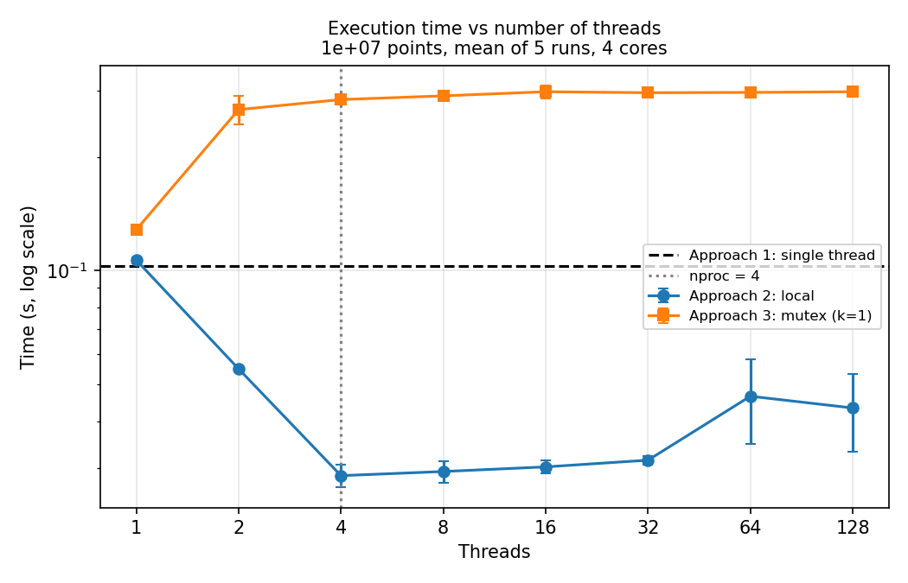
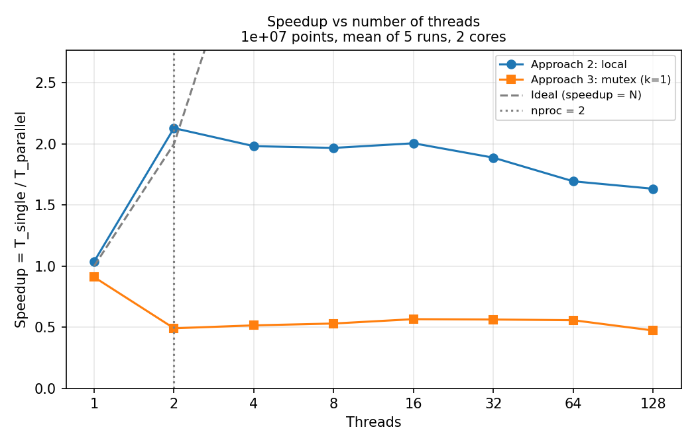
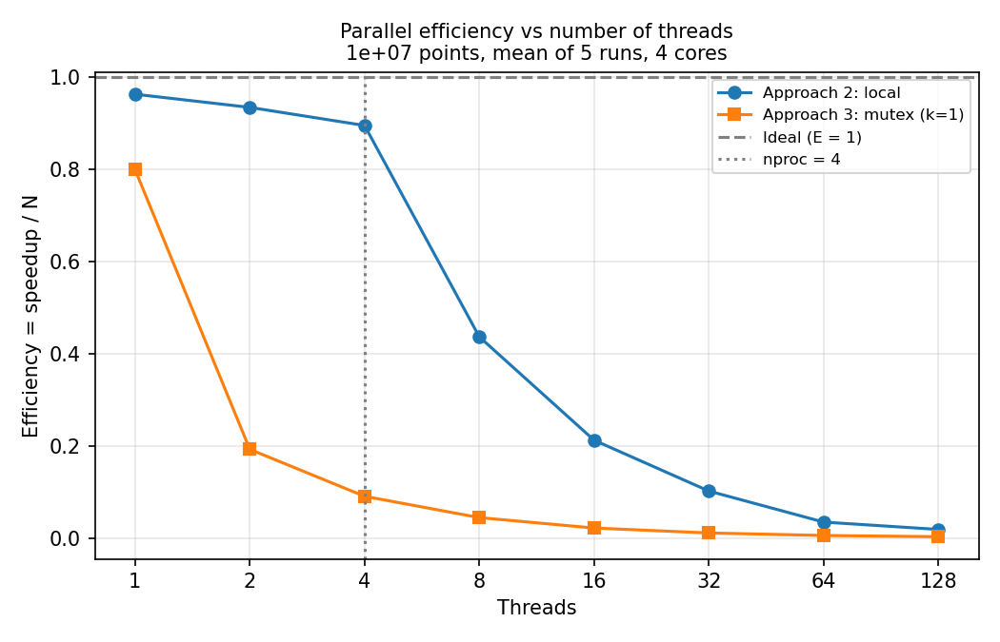
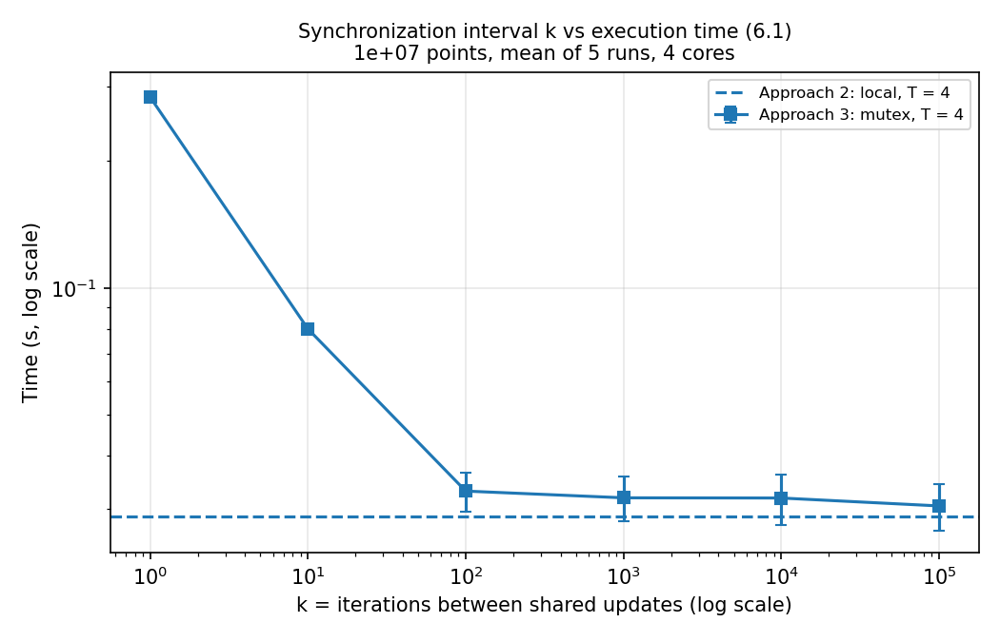

<!--
HOW TO USE THIS FILE (delete this comment before exporting)
- Every number must come from results/summary.csv or results/raw.csv. Search for "TODO(data)" to find every slot that still needs a measured value.
- "TODO(task2)" / "TODO(task3)" mark the places where the sections from
  docs/report/task2-analysis-abc-6.2.md and docs/report/task3-analysis-de-6.1-6.3.md are merged in.
- Theory paragraphs are already written; adjust them if the measurements disagree. Never bend a number to fit the text.
- Export (needs figures/*.png to exist): cd docs/report && pandoc report.md -o ../../report.pdf --pdf-engine=xelatex -V mainfont="Times New Roman" -V geometry:margin=2.2cm
-->

# 1. Objectives

This lab estimates π with a Monte Carlo method in three ways (single thread, multi-thread with local accumulation, multi-thread with a mutex-protected shared counter) and uses the measured run times to study:

- how parallel execution improves performance, and where scalability stops;
- the cost of synchronization and communication between threads;
- correct multi-threading design patterns;
- how the observed behaviour follows from OS scheduling and hardware limits.

# 2. Method

## 2.1 Monte Carlo estimation of π

A point $(x, y)$ is drawn uniformly from the unit square $[0,1]^2$. It lies inside the quarter circle of radius 1 when $x^2 + y^2 \le 1$. The quarter circle covers $\pi/4$ of the square, so

$$\pi \approx 4 \times \frac{\text{points inside}}{\text{total points}}.$$

The assignment draws the picture on $[-1,1]^2$ with a full inscribed circle; the ratio of areas is the same $\pi/4$, so both give the same estimator. The standard error with $n$ points is $4\sqrt{p(1-p)/n}$ with $p = \pi/4$, about $5\times10^{-4}$ for $n = 10^7$.

## 2.2 Measurement environment

All measurements ran on a single machine (Task 4). Source: `results/machine.txt`.

| Item | Value |
|---|---|
| Machine (physical / VM) | TODO(data) |
| CPU model | TODO(data) |
| Cores available to the OS (`nproc`) | TODO(data) |
| Threads per core (SMT) | TODO(data) |
| OS and kernel (`uname -a`) | TODO(data) |
| Compiler and flags | TODO(data) `gcc …`, `-O2 -Wall -pthread` |

## 2.3 Measurement protocol

| Parameter | Value |
|---|---|
| Points per run (`nPoints`) | $10^7$, the same for every configuration |
| Base seed | 42; thread `tid` uses seed `42 + tid` |
| Thread counts | 1, 2, 4, 8, 16, 32, 64, 128 (plus `nproc` if it is not a power of two) |
| Runs per configuration | 5 recorded runs; one discarded warm-up run for Approach 1 and 2 |
| Reported value | mean (and standard deviation) of the 5 runs |
| Timer | `clock_gettime(CLOCK_MONOTONIC)` (wall-clock time) |
| Timed interval | from just before the first `pthread_create` to just after the last `pthread_join` and the final reduction |
| Not timed | argument parsing, process start-up, printing the result |

Thread creation and joining are inside the timed interval on purpose: they are a real cost of running in parallel and part of what limits speedup at high thread counts.

`clock()` was not used because it returns the CPU time summed over all threads, which grows with the thread count even when wall-clock time falls. `rand()` was not used because glibc protects its single shared state with an internal lock, which would add hidden contention to every approach.

Metrics:

- Speedup: $S(N) = T_{single} / T_{parallel}(N)$, where $T_{single}$ is the mean time of Approach 1.
- Parallel efficiency: $E(N) = S(N) / N$.

# 3. Design of the three approaches

## 3.1 Approach 1 — single thread (baseline)

One loop draws `nPoints` points with `rand_r` on a private seed and counts the hits. Nothing is printed inside the loop. Its mean time is $T_{single}$.

## 3.2 Approach 2 — multi-thread, local accumulation (map–reduce)

TODO(task2): insert the design description from Task 2 (thread argument struct, how the remainder `nPoints % N` is distributed, private seed per thread, local counter on the thread's stack written back once).

- **Map:** each of the $N$ threads processes its share of the points and counts hits in a local variable. No shared variable is touched inside the loop, so no lock is needed.
- **Reduce:** after all threads are joined, the main thread adds the $N$ partial counts.
- The local counter is a stack variable, not an element of a shared array `count[tid]`; adjacent array elements share a cache line, and updating them from different cores on every iteration would cause false sharing.

## 3.3 Approach 3 — shared counter protected by a mutex

TODO(task3): insert the design description from Task 3.

- A global counter `g_inside` is protected by a `pthread_mutex_t`.
- Each thread counts hits in a small local batch and adds the batch to `g_inside` under the lock every `k` iterations, plus once at the end for the remainder. With `k = 1` (the standard Approach 3) the thread locks the mutex on **every** iteration; larger `k` is the trade-off experiment of Section 6.1.
- Correctness: with the same $N$ and seed, Approach 2 and Approach 3 (every `k`) produce exactly the same `inside` count, because they draw the same points. This was checked for $N$ = TODO(data). A test build with the lock removed lost updates: TODO(task3) (one measured line: expected vs obtained `inside`).

# 4. Results

## 4.1 Accuracy

| Approach | π (mean of runs) | $\lvert\pi_{est} - \pi\rvert$ |
|---|---|---|
| Single | TODO(data) | TODO(data) |
| Local, $N$ = 4 | TODO(data) | TODO(data) |
| Mutex, $N$ = 4 | TODO(data) | TODO(data) |

## 4.2 Execution time, speedup and efficiency

$T_{single}$ = TODO(data) s (mean of 5 runs, std TODO(data) s).

| Threads $N$ | Local: time (s) | Local: speedup | Local: efficiency | Mutex: time (s) | Mutex: speedup | Mutex: efficiency |
|---|---|---|---|---|---|---|
| 1 | | | | | | |
| 2 | | | | | | |
| 4 | | | | | | |
| 8 | | | | | | |
| 16 | | | | | | |
| 32 | | | | | | |
| 64 | | | | | | |
| 128 | | | | | | |

TODO(data): fill from `results/summary.csv` (rows with `k = 1` for the mutex columns).

# 5. Analysis

## A. Non-linear speedup

TODO(task2): merge Task 2's text and numbers.

Amdahl's law (lecture ch4, *Amdahl's Law*) bounds the speedup of a program whose fraction $s$ must run serially:

$$S(N) \le \frac{1}{s + (1-s)/N}.$$

The Monte Carlo loop itself is almost perfectly parallel, so in this program $s$ is small; the serial part is thread creation, joining and the final reduction, and it grows with $N$. Measured speedup falls below the ideal line for further reasons that Amdahl's formula does not model: only `nproc` threads can run at the same time; when several cores are busy the CPU may lower its clock; on a VM the host must also schedule the virtual CPUs; and the slowest thread decides when the join completes.

Measured: speedup at $N$ = 2 is TODO(data) and at $N$ = `nproc` is TODO(data), against ideal values of 2 and `nproc`. Diminishing returns appear from $N$ = TODO(data).

## B. Saturation point

TODO(task2): merge Task 2's text and numbers.

Threads only run truly in parallel up to the number of cores the OS can schedule on. Beyond that, extra threads share the same cores by time-slicing, so the total work per core does not shrink any further.

Measured: the best time of Approach 2 is TODO(data) s at $N$ = TODO(data); the machine has `nproc` = TODO(data). TODO(data): state whether the plateau starts at `nproc` and explain any difference (SMT, VM vCPUs, background load).

## C. Oversubscription

TODO(task2): merge Task 2's text and numbers.

When there are more threads than cores, the scheduler (lecture ch5) gives each runnable thread a time slice in turn. Linux's fair scheduler keeps the total CPU time constant, so the useful work done per second does not increase. Each extra thread instead adds costs:

- a context switch every time the scheduler swaps threads on a core (saving and restoring registers, and kernel time);
- caches and branch predictors partly re-warmed after each switch;
- creation and join time for each thread;
- uneven finishing times: the join waits for the last thread, so a thread that was descheduled near the end delays the whole run.

Measured: from $N$ = TODO(data) to $N$ = 128 the time of Approach 2 changes from TODO(data) s to TODO(data) s. TODO(data): compare with the sample chart in the assignment (throughput peaks at 4 threads on a 4-core machine, drops at 8, then levels off) and say where our curve agrees or differs.

## D. Synchronization cost

TODO(task3): merge Task 3's text and numbers.

The increment of `g_inside` is a critical section (lecture ch6): only one thread may execute it at a time. With `k = 1` every iteration needs the lock, so the threads spend most of their time competing for it:

- **Contention.** When the mutex is free, `pthread_mutex_lock` is a single atomic instruction in user space. When another thread holds it, the caller goes to sleep in the kernel through a futex system call, and the unlocking thread must make another system call to wake it. Each sleep and wake-up is a context switch. Each of those steps costs far more than the few arithmetic operations of one Monte Carlo sample.
- **Serialization.** Whatever the number of threads, the increments happen one after another, so the part of the loop that matters cannot speed up with more threads.
- **Cache-line transfer.** The mutex and the counter live in memory that every core writes. Each lock acquisition moves that cache line to the acquiring core, so cores keep invalidating each other's copies.

Measured: at $N$ = TODO(data) Approach 3 takes TODO(data) s against TODO(data) s for Approach 2, i.e. TODO(data)× slower; at $N$ = 1 the lock alone costs TODO(data) s compared with Approach 1.

## E. Parallel efficiency

TODO(task3): merge Task 3's text and numbers.

$E(N) = S(N)/N$ measures how much of each added thread's capacity turns into useful speedup. It stays near 1 only while every thread has its own core and the serial part is negligible. It falls once $N$ exceeds `nproc`, because $S(N)$ stops growing while $N$ keeps increasing, and it falls further as the fixed per-thread costs (creation, join, switches) accumulate. For Approach 3 the lock makes efficiency drop from the first added thread.

Measured: $E$ of Approach 2 is TODO(data) at $N$ = `nproc` and TODO(data) at $N$ = 128; $E$ of Approach 3 is TODO(data) at $N$ = 2.

# 6. Trade-off experiments

## 6.1 Synchronization frequency

TODO(task3): merge Task 3's text and numbers.

Approach 3 was run with $N$ = `nproc` = TODO(data) and $k$ = 1, 10, 100, 1 000, 10 000, 100 000. Each thread now takes the lock about `nPoints / (N·k)` times instead of once per point, so the cost of contention shrinks by a factor of $k$. Once the lock is taken rarely enough, its cost is negligible and Approach 3 runs as fast as Approach 2.

Measured: time drops from TODO(data) s at $k$ = 1 to TODO(data) s at $k$ = TODO(data), against TODO(data) s for Approach 2 at the same $N$.

## 6.2 Thread scaling

TODO(task2): merge Task 2's text and numbers.

The thread counts cover three regions: below the number of cores ($N$ < TODO(data)), equal to it, and above it up to 128. Expected shape: time decreases, then plateaus at about `nproc` threads, then stays flat or rises slightly from oversubscription overheads.

Measured: TODO(data), with reference to the time and speedup figures above.

## 6.3 Local vs shared computation

TODO(task3): merge Task 3's text and numbers.

| | Approach 2 (local) | Approach 3 (shared, $k$ = 1) |
|---|---|---|
| Critical section | none inside the loop; only the final reduction after `join` | the increment, once per iteration |
| Contention | none | every thread competes for one mutex |
| Serialization | none during the computation | all increments happen one at a time |
| Time at $N$ = `nproc` | TODO(data) s | TODO(data) s |

# 7. Best practices identified

Each practice is backed by one of our measurements.

1. **Accumulate locally, combine once (map–reduce).** Approach 2 vs Approach 3 at $N$ = TODO(data): TODO(data) s vs TODO(data) s.
2. **Match the thread count to the number of cores.** Speedup stops improving at $N$ ≈ TODO(data) = `nproc`; more threads add no speed.
3. **Synchronize as rarely as possible.** With $k$ = TODO(data) the mutex version is within TODO(data)% of the lock-free version.
4. **Give each thread its own random generator state.** `rand_r` with a private seed; the shared state of `rand()` would serialize all threads behind a hidden lock.
5. **Keep per-thread data off shared cache lines.** Count in a stack variable, not in `count[tid]` of a shared array (false sharing).
6. **Measure wall-clock time correctly.** Use `CLOCK_MONOTONIC`, not `clock()`; repeat runs and report mean and spread (our run-to-run standard deviation was TODO(data)).
7. **Check correctness, not only speed.** Same seed → identical `inside` count across approaches; removing the lock visibly lost updates.

# 8. Team and contributions

| Member (GitHub) | Task | Contribution |
|---|---|---|
| longquawns | 1 | `common.h`, Approach 1, Makefile, README, integration and submission |
| TODO | 2 | Approach 2 and analysis A, B, C, 6.2 |
| TODO | 3 | Approach 3, the `k` experiment and analysis D, E, 6.1, 6.3 |
| TODO | 4 | Benchmark script, measurements, plots |
| PTAxHVA (Tuấn Anh) | 5 | Report, code review of every pull request |

Repository: <https://github.com/PTAxHVA/os-week3-monte-carlo-pi>

# 9. Use of AI tools

As required by the course syllabus: TODO(team) — list the AI tools used (for example Claude Code for task planning and pull-request review) and what they were used for. All measurements were produced by running the group's code on the measurement machine.
